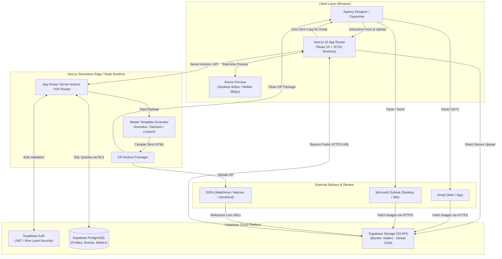
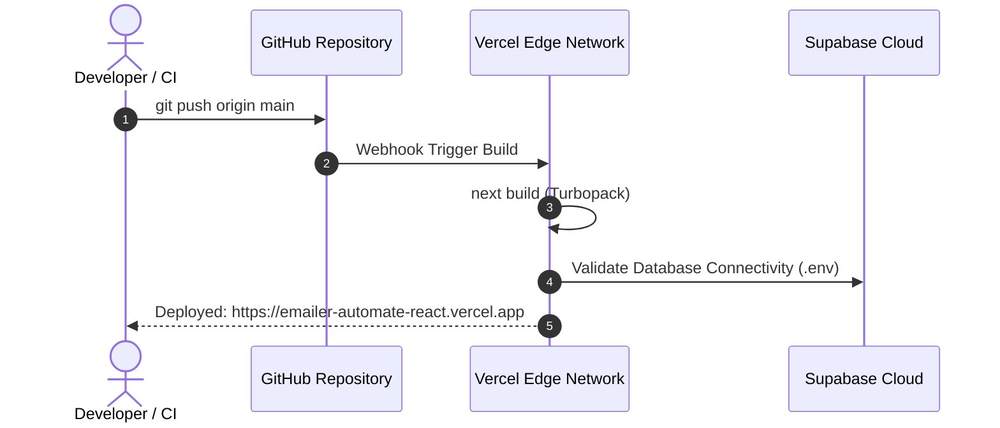

# 01 — System Architecture & Engineering Blueprint

## 1. Executive Summary

The **Emailer Automation Studio (Phase 2)** transitions from a local client-side single-page app (SPA) to a production-grade, enterprise web platform. Built on **Next.js 16 (App Router)** and **Supabase (PostgreSQL, Auth & S3-compatible Cloud Storage)**, this platform solves the core constraint of email marketing automation: **permanent, public, high-speed CDN image delivery paired with strict Outlook-compliant HTML generation.**

### Key Engineering Objectives
- **Zero Git Commits for Assets:** Uploading new deal banners or assets immediately publishes them to Supabase Storage with permanent, global HTTPS CDN URLs.
- **Enterprise Outlook Compliance:** 100% adherence to single `<p>` tag typography, VML background shapes, MSO conditional tables, and CSS resets.
- **Role-Based Access Control (RBAC):** Secure team access for studio designers, copywriters, and client reviewers with Supabase Auth.
- **Modern Code Standards:** Strict compliance with Next.js 16 App Router standards (JavaScript only, SCSS Modules, `@/` path aliases, designated component comment blocks).

---

## 2. High-Level System Architecture



---

## 3. Core Subsystems

### 3.1. Cloud Asset Storage Subsystem
- **Provider:** Supabase Storage (backed by AWS S3 & Cloudflare CDN).
- **Bucket Configuration:** `mailers` (Public Read, Authenticated Write).
- **Public URL Pattern:**
  ```text
  https://[project-id].supabase.co/storage/v1/object/public/mailers/deals/[brand]/[folder_name]/[filename]
  ```
- **Image Lifecycle:**
  1. User selects a local image (`.jpg`, `.png`, `.webp`).
  2. Client validates dimensions (minimum 600px width for banners) and file size (max 5MB).
  3. Client uploads directly to Supabase via `@supabase/supabase-js`.
  4. Supabase generates a permanent, high-availability public HTTPS URL.
  5. The URL is automatically injected into the mailer draft record and the HTML email template.

### 3.2. Email Template Engine Subsystem
- **Standards:** Avendus Capital Strict Email Standard.
- **Structure:**
  - Standard MSO / VML office document XML headers.
  - Reset styles for Apple Mail, Outlook 2016/2019/365, Gmail, and Yahoo.
  - Dynamic Banner Block: 600px fixed width, fluid 100% mobile scaling.
  - Body Content Block: Strictly contained within a **single `<p>` tag**, utilizing nested `<span>` elements for typography and `<br /><br />` for paragraph breaks.
  - Action Button Block: Bulletproof VML rounded rectangle (`v:roundrect`) for Outlook desktop and CSS-styled `<a>` tags for modern clients.
  - Footer Navigation & Social Block: Pre-deployed brand assets served with absolute HTTPS links.

### 3.3. Authentication & Security Subsystem
- **Provider:** Supabase Auth with JWT stored in secure HTTP-only cookies via `@supabase/ssr`.
- **Row Level Security (RLS):**
  - Designers/Editors can create, view, edit, and delete their own drafts.
  - Admins can view and approve all drafts across all brands.
  - Viewers (Clients) can only view approved mailer previews.

---

## 4. Technology Stack & Integration Matrix

| Layer | Technology | Version | Purpose |
| :--- | :--- | :--- | :--- |
| **Framework** | Next.js (App Router) | 16.4.x | React Server Components, server actions, dynamic routing |
| **UI Library** | React | 19.2.x | Component lifecycle, hooks, interactive UI |
| **Language** | JavaScript (ES6+) | Latest | Strict adherence to modern standards (no TypeScript) |
| **Styling** | SCSS Modules | 1.89.x | Scoped styles per component/page, shared global mixins |
| **Database** | Supabase PostgreSQL | 15+ | Relational schema, JSONB support, relational integrity |
| **Storage** | Supabase Storage | S3-compatible | Fast global CDN file hosting for email images |
| **Authentication** | Supabase Auth (`@supabase/ssr`) | Latest | Cookie-based session management for Next.js App Router |
| **Form Handling** | `react-hook-form` | 7.61.x | Controlled forms, validation, dynamic inputs |
| **Archive Bundler** | `jszip` | 3.10.x | Clean in-browser ZIP generation without extraneous directories |
| **Fonts** | Poppins & Inter | Google Fonts | Agency brand typography via `next/font/google` |

---

## 5. Deployment Architecture



- **Production URL:** Hosted on Vercel with automated GitHub integration.
- **Environment Isolation:**
  - `NEXT_PUBLIC_SUPABASE_URL`: Public Supabase Project Endpoint.
  - `NEXT_PUBLIC_SUPABASE_ANON_KEY`: Safe public key for browser client.
  - `SUPABASE_SERVICE_ROLE_KEY`: Server-only secret key for elevated backend operations.
