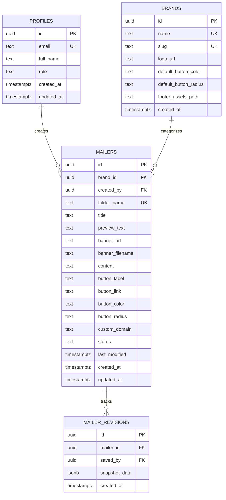

# 02 — Supabase PostgreSQL Database Schema & RLS Security

## 1. Schema Architecture Overview

The database design provides relational integrity, audit trails, and strict role-based access control. All queries from Next.js enforce **Row Level Security (RLS)** via user session JWTs.



---

## 2. Production SQL Migration Script

Run this SQL script directly in the **Supabase SQL Editor** to initialize the full schema:

```sql
-- ============================================================================
-- 1. EXTENSIONS & ENUMS
-- ============================================================================
CREATE EXTENSION IF NOT EXISTS "uuid-ossp";

CREATE TYPE user_role AS ENUM ('admin', 'editor', 'viewer');
CREATE TYPE mailer_status AS ENUM ('draft', 'review', 'approved', 'archived');

-- ============================================================================
-- 2. PROFILES TABLE (Linked to auth.users)
-- ============================================================================
CREATE TABLE public.profiles (
    id UUID PRIMARY KEY REFERENCES auth.users(id) ON DELETE CASCADE,
    email TEXT NOT NULL UNIQUE,
    full_name TEXT,
    role user_role DEFAULT 'editor'::user_role NOT NULL,
    created_at TIMESTAMPTZ DEFAULT TIMEZONE('utc'::text, NOW()) NOT NULL,
    updated_at TIMESTAMPTZ DEFAULT TIMEZONE('utc'::text, NOW()) NOT NULL
);

-- Automatic Profile Creation Trigger on Signup
CREATE OR REPLACE FUNCTION public.handle_new_user()
RETURNS TRIGGER AS $$
BEGIN
    INSERT INTO public.profiles (id, email, full_name, role)
    VALUES (
        NEW.id,
        NEW.email,
        COALESCE(NEW.raw_user_meta_data->>'full_name', split_part(NEW.email, '@', 1)),
        'editor'::user_role
    );
    RETURN NEW;
END;
$$ LANGUAGE plpgsql SECURITY DEFINER;

CREATE OR REPLACE TRIGGER on_auth_user_created
    AFTER INSERT ON auth.users
    FOR EACH ROW EXECUTE FUNCTION public.handle_new_user();

-- ============================================================================
-- 3. BRANDS TABLE
-- ============================================================================
CREATE TABLE public.brands (
    id UUID PRIMARY KEY DEFAULT uuid_generate_v4(),
    name TEXT NOT NULL UNIQUE,
    slug TEXT NOT NULL UNIQUE,
    description TEXT,
    logo_url TEXT,
    default_button_color TEXT DEFAULT '#cc1919' NOT NULL,
    default_button_radius TEXT DEFAULT '43px' NOT NULL,
    footer_assets_path TEXT DEFAULT 'assets/avendus/img/' NOT NULL,
    created_at TIMESTAMPTZ DEFAULT TIMEZONE('utc'::text, NOW()) NOT NULL
);

-- ============================================================================
-- 4. MAILERS TABLE (Core Emailer Entity)
-- ============================================================================
CREATE TABLE public.mailers (
    id UUID PRIMARY KEY DEFAULT uuid_generate_v4(),
    brand_id UUID NOT NULL REFERENCES public.brands(id) ON DELETE RESTRICT,
    created_by UUID NOT NULL REFERENCES public.profiles(id) ON DELETE SET NULL,
    folder_name TEXT NOT NULL,
    title TEXT NOT NULL,
    preview_text TEXT DEFAULT '',
    banner_url TEXT NOT NULL,
    banner_filename TEXT DEFAULT 'bannerNew.jpg' NOT NULL,
    content TEXT NOT NULL,
    button_label TEXT DEFAULT 'Know More' NOT NULL,
    button_link TEXT DEFAULT 'https://www.avendus.com' NOT NULL,
    button_color TEXT DEFAULT '#cc1919' NOT NULL,
    button_radius TEXT DEFAULT '43px' NOT NULL,
    custom_domain TEXT DEFAULT '',
    status mailer_status DEFAULT 'draft'::mailer_status NOT NULL,
    last_modified TIMESTAMPTZ DEFAULT TIMEZONE('utc'::text, NOW()) NOT NULL,
    created_at TIMESTAMPTZ DEFAULT TIMEZONE('utc'::text, NOW()) NOT NULL,
    updated_at TIMESTAMPTZ DEFAULT TIMEZONE('utc'::text, NOW()) NOT NULL,
    CONSTRAINT unique_brand_folder UNIQUE (brand_id, folder_name)
);

-- ============================================================================
-- 5. MAILER REVISIONS TABLE (Audit & Version History)
-- ============================================================================
CREATE TABLE public.mailer_revisions (
    id UUID PRIMARY KEY DEFAULT uuid_generate_v4(),
    mailer_id UUID NOT NULL REFERENCES public.mailers(id) ON DELETE CASCADE,
    saved_by UUID REFERENCES public.profiles(id) ON DELETE SET NULL,
    snapshot_data JSONB NOT NULL,
    created_at TIMESTAMPTZ DEFAULT TIMEZONE('utc'::text, NOW()) NOT NULL
);

-- ============================================================================
-- 6. INDEXES FOR PERFORMANCE
-- ============================================================================
CREATE INDEX idx_mailers_brand_id ON public.mailers(brand_id);
CREATE INDEX idx_mailers_created_by ON public.mailers(created_by);
CREATE INDEX idx_mailers_status ON public.mailers(status);
CREATE INDEX idx_mailers_last_modified ON public.mailers(last_modified DESC);
CREATE INDEX idx_revisions_mailer_id ON public.mailer_revisions(mailer_id);

-- ============================================================================
-- 7. AUTOMATIC TIMESTAMP UPDATE TRIGGER
-- ============================================================================
CREATE OR REPLACE FUNCTION public.handle_updated_at()
RETURNS TRIGGER AS $$
BEGIN
    NEW.updated_at = TIMEZONE('utc'::text, NOW());
    NEW.last_modified = TIMEZONE('utc'::text, NOW());
    RETURN NEW;
END;
$$ LANGUAGE plpgsql;

CREATE TRIGGER trigger_update_mailers_timestamp
    BEFORE UPDATE ON public.mailers
    FOR EACH ROW EXECUTE FUNCTION public.handle_updated_at();

-- ============================================================================
-- 8. ROW LEVEL SECURITY (RLS) POLICIES
-- ============================================================================
ALTER TABLE public.profiles ENABLE ROW LEVEL SECURITY;
ALTER TABLE public.brands ENABLE ROW LEVEL SECURITY;
ALTER TABLE public.mailers ENABLE ROW LEVEL SECURITY;
ALTER TABLE public.mailer_revisions ENABLE ROW LEVEL SECURITY;

-- Profiles: Authenticated users can read all profiles; users can update their own
CREATE POLICY "Allow authenticated read profiles"
    ON public.profiles FOR SELECT
    TO authenticated
    USING (true);

CREATE POLICY "Allow users update own profile"
    ON public.profiles FOR UPDATE
    TO authenticated
    USING (auth.uid() = id);

-- Brands: All authenticated users can read brands; only admins can modify
CREATE POLICY "Allow authenticated read brands"
    ON public.brands FOR SELECT
    TO authenticated
    USING (true);

CREATE POLICY "Allow admins write brands"
    ON public.brands FOR ALL
    TO authenticated
    USING (
        EXISTS (
            SELECT 1 FROM public.profiles
            WHERE id = auth.uid() AND role = 'admin'
        )
    );

-- Mailers: Authenticated users can view, insert, and update mailers
CREATE POLICY "Allow authenticated read mailers"
    ON public.mailers FOR SELECT
    TO authenticated
    USING (true);

CREATE POLICY "Allow authenticated insert mailers"
    ON public.mailers FOR INSERT
    TO authenticated
    WITH CHECK (auth.uid() = created_by);

CREATE POLICY "Allow owner or admin update mailers"
    ON public.mailers FOR UPDATE
    TO authenticated
    USING (
        auth.uid() = created_by OR
        EXISTS (
            SELECT 1 FROM public.profiles
            WHERE id = auth.uid() AND role = 'admin'
        )
    );

CREATE POLICY "Allow owner or admin delete mailers"
    ON public.mailers FOR DELETE
    TO authenticated
    USING (
        auth.uid() = created_by OR
        EXISTS (
            SELECT 1 FROM public.profiles
            WHERE id = auth.uid() AND role = 'admin'
        )
    );

-- Revisions: All authenticated can view; editors can create
CREATE POLICY "Allow authenticated read revisions"
    ON public.mailer_revisions FOR SELECT
    TO authenticated
    USING (true);

CREATE POLICY "Allow authenticated insert revisions"
    ON public.mailer_revisions FOR INSERT
    TO authenticated
    WITH CHECK (auth.uid() = saved_by);
```

---

## 3. Seed Data (Initial Brands & Master Deals)

Execute this script after running the migration to populate Avendus, Sanctum, Custom, and the master seed deals:

```sql
-- 1. Insert Brands
INSERT INTO public.brands (id, name, slug, description, default_button_color, default_button_radius, footer_assets_path)
VALUES
    ('11111111-1111-1111-1111-111111111111', 'Avendus Capital', 'avendus', 'Formal M&A deal announcements, quarterly ECM updates, and research newsletters.', '#cc1919', '43px', 'assets/avendus/img/'),
    ('22222222-2222-2222-2222-222222222222', 'Sanctum Wealth', 'sanctum', 'Wealth management advisory updates and high-net-worth portfolio digests.', '#1a365d', '4px', 'assets/sanctum/img/'),
    ('33333333-3333-3333-3333-333333333333', 'Custom Emailer', 'custom', 'Flexible brand workspace with dynamic colors, logos, and custom signatures.', '#2563eb', '8px', 'assets/custom/img/')
ON CONFLICT (slug) DO NOTHING;

-- 2. Seed Master Deal: KSH Group (Reference template)
-- Replace 'USER_UUID_HERE' with your real Supabase user UUID after creating an account
/*
INSERT INTO public.mailers (
    brand_id,
    created_by,
    folder_name,
    title,
    preview_text,
    banner_url,
    banner_filename,
    content,
    button_label,
    button_link,
    button_color,
    button_radius,
    status
) VALUES (
    '11111111-1111-1111-1111-111111111111',
    'USER_UUID_HERE',
    'deal_KSH_Group',
    'KSH Group sells 100% stake in KSH Distriparks to Delhi International Cargo Terminals for USD 35 mn',
    'KSH Group sells 100% stake in KSH Distriparks to Delhi International Cargo Terminals for USD 35 mn',
    'https://xyz.supabase.co/storage/v1/object/public/mailers/deals/avendus/deal_KSH_Group/bannerNew.jpg',
    'bannerNew.jpg',
    '**KSH Group sells 100% stake in KSH Distriparks to Delhi International Cargo Terminals for USD 35 mn**\n\nThe shareholders of KSH Distriparks Private Limited (“KSH”/Company), operator of Pune’s largest Inland Container Depot (“ICD”), have sold their 100% stake in the company to Delhi International Cargo Terminals Private Limited (jointly owned by J M Baxi Group and Hapag Lloyd).\n\n**Avendus Capital acted as the exclusive financial advisor to KSH and its shareholders on this transaction.**',
    'Know More',
    'https://www.avendus.com/transactions/ksh-group-sells-100-stake-in-ksh-distriparks-to-delhi-international-cargo-terminals-for-usd-35-mn',
    '#cd2027',
    '3px',
    'approved'
);
*/
```
