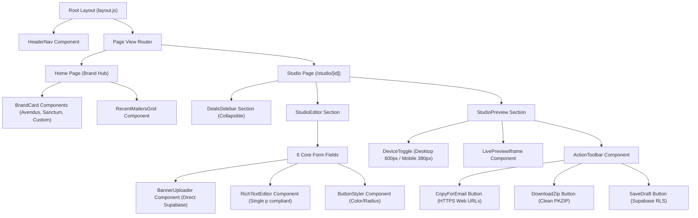

# 04 — Next.js 16 Component Breakdown & UI Architecture

## 1. Compliance with Next.js 16 Base Template Standards

Following the project architecture conventions:
- **Language:** JavaScript only (`.js` / `.jsx`). **Zero TypeScript files.**
- **Styling:** SCSS Modules (`*.module.scss`) + Global SCSS variables (`@/styles/globals/...`).
- **Scaffold Commands:** All components, sections, and pages must be created using the repository scripts:
  ```bash
  npm run create-page studio
  npm run create-section StudioEditor
  npm run create-component BannerUploader
  ```
- **Comment-Block Standard:** All component files adhere to:
  ```javascript
  // MODULES //
  // COMPONENTS //
  // SECTIONS //
  // PLUGINS //
  // UTILS //
  // STYLES //
  import styles from "./ComponentName.module.scss";
  ```

---

## 2. Page Routes Hierarchy (`src/app/`)

```text
src/app/
├── layout.js                         # Root Layout (Poppins/Inter fonts, Lenis smooth scroll)
├── page.js                           # Home Hub (Brand workspace cards: Avendus, Sanctum, Custom)
│
├── login/
│   ├── page.js                       # Team Authentication (Supabase Auth Login/Signup)
│   └── page.module.scss
│
├── dashboard/
│   ├── page.js                       # All Mailers Management (Table view, search, filters)
│   └── page.module.scss
│
└── studio/
    ├── page.js                       # Studio Redirect to active deal or new draft
    │
    ├── new/
    │   ├── page.js                   # Create New Mailer Draft
    │   └── page.module.scss
    │
    └── [id]/
        ├── page.js                   # Main Emailer Editor (Form, Live Preview, Supabase Sync)
        └── page.module.scss
```

---

## 3. UI Component & Section Breakdown



---

## 4. Component Inventory & Responsibilities

| Component / Section | Location | Responsibility |
| :--- | :--- | :--- |
| **`HeaderNav`** | `src/components/HeaderNav/` | Top bar with brand switcher, origin URL input, and user profile/logout. |
| **`DealsSidebar`** | `src/sections/DealsSidebar/` | Collapsible sidebar listing saved drafts, search filter, and `+ New` button. |
| **`StudioEditor`** | `src/sections/StudioEditor/` | Center form panel handling all 6 required email fields with `react-hook-form`. |
| **`StudioPreview`** | `src/sections/StudioPreview/` | Right-hand container holding the live preview iframe and export buttons. |
| **`BannerUploader`** | `src/components/BannerUploader/` | Drag-and-drop file upload directly to Supabase Storage with progress bar. |
| **`RichTextEditor`** | `src/components/RichTextEditor/` | Markdown bold `**text**` and visual `Ctrl+B` button with single `<p>` preview. |
| **`LivePreviewIframe`** | `src/components/LivePreviewIframe/` | Sandboxed `<iframe>` executing dynamic master template HTML. |
| **`ActionToolbar`** | `src/components/ActionToolbar/` | `Generate`, `Update Tab`, `Copy for Email`, and `Download ZIP` actions. |
| **`BrandCard`** | `src/components/BrandCard/` | Workspace selector cards on the Home view with active/coming-soon badges. |
| **`ToastNotification`** | `src/components/ToastNotification/` | Floating status messages for saves, uploads, and copy confirmations. |

---

## 5. State Management & Data Flow

```javascript
// src/app/studio/[id]/page.js (Conceptual Pattern)
"use client";

// MODULES //
import { useState, useEffect } from "react";
import { useForm } from "react-hook-form";

// COMPONENTS //
import HeaderNav from "@/components/HeaderNav";
import ToastNotification from "@/components/ToastNotification";

// SECTIONS //
import DealsSidebar from "@/sections/DealsSidebar";
import StudioEditor from "@/sections/StudioEditor";
import StudioPreview from "@/sections/StudioPreview";

// SERVICES //
import { MailerService } from "@/services/mailerService";
import { StorageService } from "@/services/storageService";

// UTILS //
import { TemplateGenerator } from "@/utils/templateGenerator";

// STYLES //
import styles from "./StudioPage.module.scss";

export default function StudioPage({ params }) {
  const [activeMailer, setActiveMailer] = useState(null);
  const [previewDevice, setPreviewDevice] = useState("desktop"); // 'desktop' | 'mobile'
  const [isSaving, setIsSaving] = useState(false);

  const { register, handleSubmit, setValue, watch } = useForm();
  const formData = watch();

  // Live compilation of compliant Avendus HTML on every keystroke
  const liveHtml = TemplateGenerator.generate(formData, {
    isLivePreview: true
  });

  // Direct banner upload to Supabase Storage
  const handleBannerUpload = async (file) => {
    const { publicUrl, filename } = await StorageService.uploadBanner(
      file,
      formData.brand,
      formData.folderName
    );
    setValue("bannerUrl", publicUrl);
    setValue("bannerFilename", filename);
  };

  return (
    <div className={styles.studioLayout}>
      <HeaderNav />
      <main className={styles.studioBody}>
        <DealsSidebar />
        <StudioEditor
          register={register}
          onBannerUpload={handleBannerUpload}
        />
        <StudioPreview
          html={liveHtml}
          device={previewDevice}
          onDeviceChange={setPreviewDevice}
          formData={formData}
        />
      </main>
      <ToastNotification />
    </div>
  );
}
```
